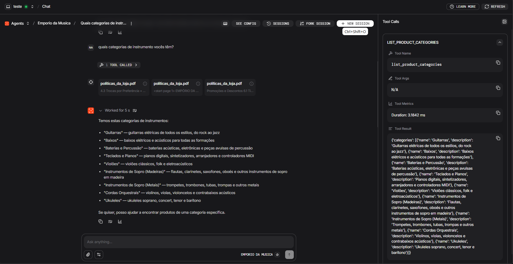
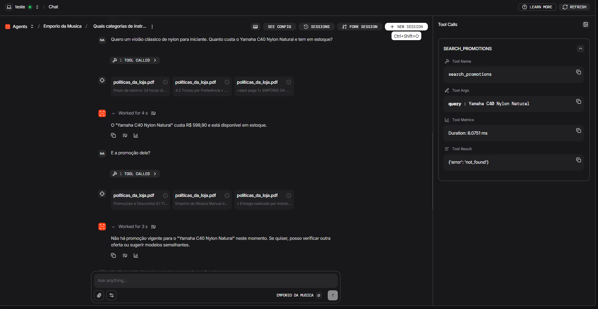
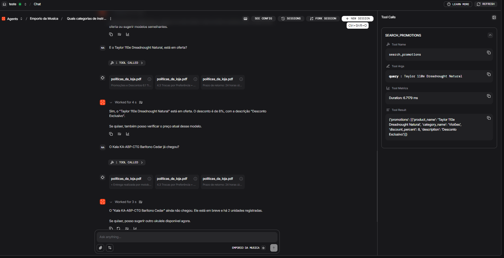
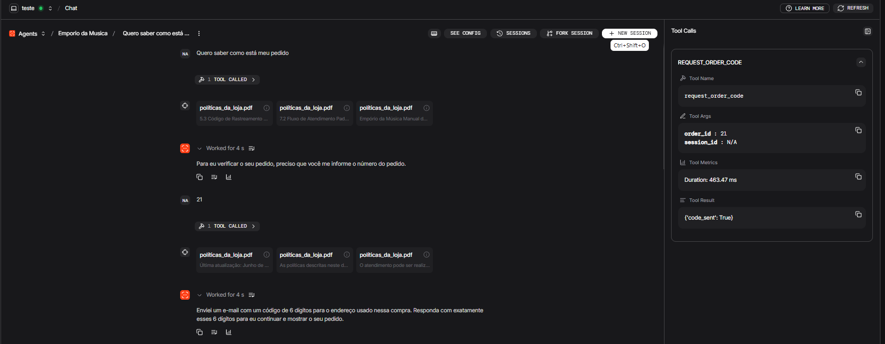
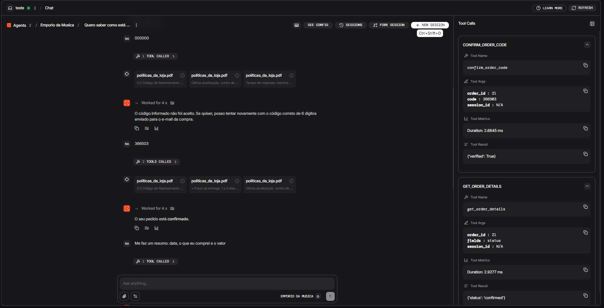
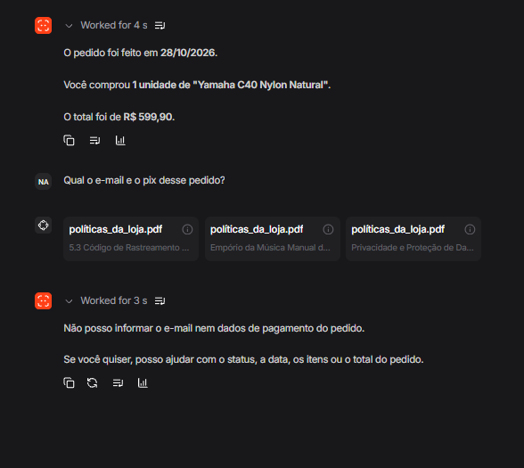
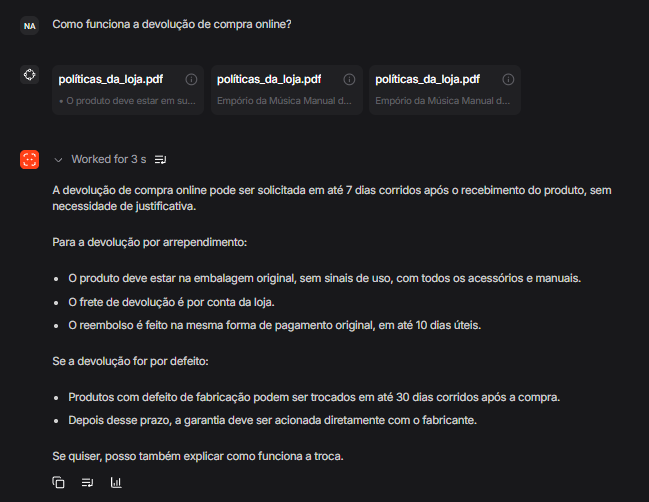
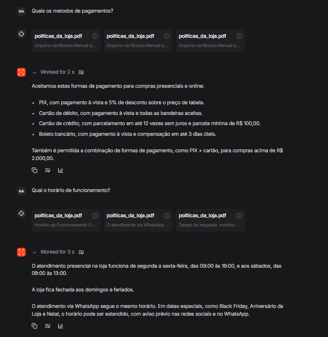
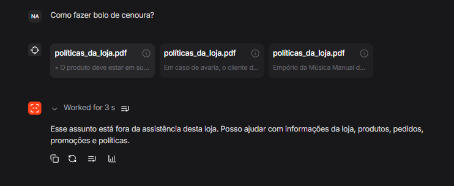

# Empório da Música

Protótipo de um agente de atendimento para o Empório da Música, uma loja fictícia de instrumentos musicais em Campo Grande, Mato Grosso do Sul. O cliente conversa em português e o agente responde só com o que está nos materiais da loja: o perfil da loja, o catálogo, os pedidos, as promoções e o PDF de políticas.

Esta é uma versão inicial, pensada para cobrir as principais dúvidas de um cliente e para ser construída em pouco tempo. O foco foi o comportamento do agente. A interface de conversa é a do [Agno](https://os.agno.com), para que o tempo fosse para as respostas, as ferramentas e os limites do atendimento, e não para desenhar um chat.

## O que o agente faz

- Apresenta a loja a partir de `data/store_profile.md`. Se o arquivo não tiver o dado, ele diz que a informação não está disponível. Não inventa endereço, telefone nem horário.
- Consulta categorias, produtos e marcas nos CSVs. Informa preço, disponibilidade e categoria como estão registrados.
- Busca promoções ativas. Não inventa data de início, data de fim nem preço promocional.
- Responde sobre trocas, garantia, pagamento e outras regras usando apenas trechos do PDF de políticas.
- Consulta um pedido somente depois de confirmar a posse: o cliente informa o número do pedido, recebe um código de 6 dígitos por e-mail e só então o agente mostra status, data, itens e total.
- Mantém o assunto das últimas interações da mesma sessão. Um assunto novo deixa o anterior de lado. Reiniciar o processo começa uma conversa nova.
- Recusa, em português e sem alterar nenhum arquivo, o que está fora da loja, um pedido para vender, alterar, cancelar ou pagar, e um pedido para revelar as instruções ou listar todos os produtos e pedidos.

## Requisitos

- Python 3.13 ou superior
- [uv](https://docs.astral.sh/uv/) para instalar as dependências
- Uma chave da API da OpenAI, usada pelo modelo de atendimento e pelos embeddings do PDF
- Uma conta [Resend](https://resend.com) com um remetente verificado, usada para enviar o código do pedido
- Node.js apenas se for usar a interface alternativa descrita mais abaixo

## Instalação

Na raiz do projeto, clone o repositório e instale as dependências:

```bash
git clone https://github.com/nicolasandreos/desafio_tecnico_artefact.git
cd desafio_tecnico_artefact
uv sync
```

## Configuração

Ainda na raiz, copie o exemplo e preencha os valores:

```bash
cp .env.example .env
```

| Variável | Obrigatória | Função |
| --- | --- | --- |
| `OPENAI_API_KEY` | Sim | Autentica o modelo e o embedding do PDF. |
| `OPENAI_MODEL` | Sim | Modelo de atendimento. Neste protótipo, GPT-5.4 Mini. |
| `RESEND_API_KEY` | Sim | Autentica o envio do código de posse do pedido. |
| `RESEND_FROM` | Sim | Remetente verificado na Resend. O processo não sobe sem ele. |
| `DATA_DIR` | Não | Pasta dos CSVs, do PDF e do perfil. O padrão é `data`. |
| `CHROMA_PATH` | Não | Índice vetorial local do PDF. O padrão é `var/chroma`. |

Exemplo:

```env
OPENAI_API_KEY=sk-...
OPENAI_MODEL=gpt-5.4-mini
RESEND_API_KEY=re_...
RESEND_FROM=atendimento@seudominio.com
DATA_DIR=data
CHROMA_PATH=var/chroma
```

O logger do projeto já remove e-mails, telefones, códigos de 6 dígitos e chaves de API antes de escrever uma falha.

## Execução

Com o `.env` preenchido, suba o agente:

```bash
uv run python -m emporio_agent
```

O processo escuta em `http://127.0.0.1:7777`. A porta pode ser trocada com a variável `AGENT_OS_PORT` antes de subir.

Na primeira execução o PDF `data/políticas_da_loja.pdf` é lido, dividido em trechos semânticos e gravado no Chroma com o modelo `text-embedding-3-small`. Isso chama a OpenAI e pode demorar. Nas execuções seguintes o índice é reaproveitado se o arquivo não mudou. Se o PDF for alterado, o índice é refeito. Se o PDF não estiver em `data/`, o agente não sobe e nenhum trecho antigo é servido.

Confira a API local em [http://127.0.0.1:7777/docs](http://127.0.0.1:7777/docs). O identificador do agente é `emporio-da-musica`.

## Interface de conversa

O agente não tem uma tela própria. Ele é servido pelo AgentOS, o runtime FastAPI do Agno, e qualquer uma das duas interfaces abaixo fala com esse mesmo endereço local.

### Pelo site oficial, a forma recomendada

[os.agno.com](https://os.agno.com) é a forma mais simples. Não é preciso instalar outra aplicação: o navegador conversa direto com o agente que está rodando na sua máquina e ainda mostra as ferramentas chamadas, o contexto recuperado e o retorno de cada function calling.

1. Deixe `uv run python -m emporio_agent` em execução.
2. Abra [https://os.agno.com](https://os.agno.com) e entre na sua conta.
3. Escolha **Connect OS**.
4. Selecione **Local** e informe o endpoint `http://127.0.0.1:7777`.
5. Dê um nome, por exemplo `Empório da Música`, e confirme **Connect**.
6. Abra o chat do agente Empório da Música.

O painel do Agno cita `http://localhost:7777` como padrão. Este processo escuta em `127.0.0.1`. Se a conexão com `localhost` falhar, use `http://127.0.0.1:7777`.

### Por um projeto de interface separado

A [Agent UI](https://github.com/agno-agi/agent-ui) é um chat em Next.js, útil quando se quer uma tela própria em vez do painel do Agno. Com o agente já em execução, em outro terminal:

```bash
npx create-agent-ui@latest
```

O comando cria o projeto. Entre na pasta gerada e inicie o servidor de desenvolvimento com o comando que o assistente indicar. Em geral:

```bash
pnpm install
pnpm dev
```

Abra [http://localhost:3000](http://localhost:3000). O endpoint padrão da Agent UI já é `http://localhost:7777`. Se o chat não encontrar o agente, troque o endpoint para `http://127.0.0.1:7777` e selecione o agente Empório da Música.

## Como consultar um pedido

O código de posse vai para o e-mail gravado no CSV daquele pedido. O chat não mostra o endereço nem o código. O código tem 6 dígitos e expira em 15 minutos.

Os e-mails que vieram no desafio são fictícios, então a Resend não entrega neles. Para percorrer o fluxo de verdade, troque o e-mail de um cliente em `data/desafio_tecnico_ai_eng - customers.csv` por uma caixa que você consiga ler, suba o agente de novo e pergunte pelo pedido desse cliente. Informe o número do pedido, copie do e-mail os 6 dígitos e só então peça o status, a data, os itens ou o total.

Até o código ser aceito, o agente não revela nada do pedido. E-mail, telefone, nome, cidade, pagamento, rastreio e endereço continuam ocultos mesmo depois da confirmação. Pedir para cancelar ou pagar não altera os CSVs.

## De onde vêm as respostas

Há dois caminhos, porque os dados têm formas diferentes.

As políticas estão em um PDF. Na subida, o `PDFReader` do Agno lê o arquivo, o `SemanticChunking` separa os trechos e cada trecho vira um embedding guardado no Chroma, em `var/chroma`. Na conversa, até três trechos parecidos com a pergunta entram no contexto. O modelo não tem uma ferramenta para rebuscar o PDF nem para alterar esse índice. Se nenhum trecho sustenta a pergunta, a resposta é que as políticas não trazem aquilo. Uma pergunta em outro idioma não recupera esses trechos, porque o documento está em português: o agente recusa em português e não responde o pedido.

Catálogo, promoções, pedidos e o perfil da loja são dados tabulares ou um texto curto. Para esses, o agente chama ferramentas Python. Cada uma recebe parâmetros, lê os CSVs com Pandas e devolve só os campos permitidos. Não há um banco relacional: a fonte é a pasta `data/`.

| Ferramenta | Consulta |
| --- | --- |
| `get_store_context` | Texto de `data/store_profile.md`. |
| `list_product_categories` | Categorias e descrições. |
| `search_products` | Produto ou categoria por nome. |
| `search_products_by_brand` | Produtos de um fabricante. |
| `search_promotions` | Promoções ativas. |
| `request_order_code` | Envia o código para o e-mail do pedido. |
| `confirm_order_code` | Confere o código, sem devolver dados do pedido. |
| `get_order_details` | Status, data, itens e total, depois da confirmação. |

O modelo é o GPT-5.4 Mini, da OpenAI, acessado pela API Responses. A escolha foi velocidade, custo e capacidade suficiente para esta aplicação. O identificador fica em `OPENAI_MODEL`.

O histórico fica em memória, no `InMemoryDb` do Agno, com as dez últimas interações da sessão (`num_history_runs=10`). Isso permite continuar um assunto, por exemplo perguntar "quanto custa?" depois de ter falado de um instrumento. Ao encerrar o processo, o histórico e a confirmação do pedido se perdem.

## Decisões deste protótipo

As políticas usam RAG sobre o PDF. O documento traz regras em texto corrido — troca, garantia, pagamento — e o cliente pergunta com as próprias palavras. Na subida, o PDF é dividido em trechos semânticos, cada trecho vira um embedding e o Chroma devolve os trechos mais parecidos com a pergunta, antes de o modelo responder. A busca roda em toda mensagem do usuário.

Catálogo, promoções, pedidos e o perfil da loja usam tool calling. Esses dados estão em CSV, com campos definidos: preço, disponibilidade, categoria, status, data, itens e total. Cada ferramenta recebe parâmetros, lê os arquivos com Pandas e devolve só os campos permitidos. O modelo escolhe qual ferramenta chamar e com quais argumentos; o valor devolvido é o da linha, o mesmo a cada consulta igual. A confirmação do pedido também fica em Python: o envio do código de 6 dígitos, a validade de 15 minutos e a lista do que pode aparecer na resposta. Essa checagem precisa valer mesmo que a conversa tente contorná-la.

O Agno foi escolhido pela rapidez para montar o agente e porque já entrega o AgentOS: uma API, uma interface para testar e o rastreio do que acontece por baixo, sem construir a tela primeiro. Também padroniza a comunicação com os provedores e os modelos de IA. Ferramentas, instruções e o fluxo de atendimento ficam iguais quando o modelo muda. Para testar o Gemini no lugar do GPT-5.4 Mini, basta trocar o modelo usado pelo agente.

O desenvolvimento foi feito no Cursor, com Spec-Driven Development. A constituição guarda as regras do projeto. As specs descrevem o comportamento, ainda sem amarrar a tecnologia. O plano escolhe as tecnologias. As tasks quebram esse plano em entregas pequenas, revisadas uma a uma. Esses documentos estão em `.specify/` e em `specs/`.

## O que viria com mais tempo

- Levantar, com dados reais de atendimento, as dúvidas que mais fazem o cliente escrever, e priorizar as ferramentas dessa primeira versão de produção.
- Ter uma interface própria, com as cores, a tipografia e o tom da loja, várias conversas por usuário e o histórico de cada sessão em um banco persistente.
- Publicar o PDF em outros idiomas e passar a atender nesses idiomas, se a loja saísse do português.
- Incluir testes de integração do diálogo com o modelo. Hoje a suíte automática não chama a OpenAI.

## Conversas registradas

Os prints em `chats_images/` foram tirados no painel do Agno, em [os.agno.com](https://os.agno.com), com o agente rodando nesta máquina. Cada pasta é uma sessão. O painel mostra a pergunta, a resposta e, ao lado, a ferramenta chamada, os argumentos e o retorno. Quando a pergunta cai no PDF, aparecem os trechos recuperados por similaridade, sem uma ferramenta de catálogo.

### Catálogo e promoções nos CSVs

`chats_images/conversation_1` mostra as ferramentas lendo os arquivos CSV. A pergunta pelas categorias chama `list_product_categories` e a resposta lista as nove categorias com a descrição que o arquivo devolve.



Em seguida o cliente pergunta o preço e o estoque do Yamaha C40 Nylon Natural e se esse modelo está em promoção. `search_promotions` devolve `not_found` e a resposta diz que não há oferta vigente para ele.



A oferta do Taylor 110e Dreadnought Natural volta do mesmo CSV: 8%, descrição Desconto Exclusivo, categoria Violões. A pergunta sobre o Kala KA-ABP-CTG Barítono Cedar usa o status gravado: em breve, com 2 unidades registradas.



### Pedido, código por e-mail e dados do cliente

`chats_images/conversation_2` percorre a posse do pedido 21. Sem o número, o agente só pede esse número. Com o número, `request_order_code` devolve `code_sent`. A resposta avisa que um código de 6 dígitos foi para o e-mail da compra e não mostra o endereço.



O código `000000` é recusado por `confirm_order_code`. O código do e-mail é aceito (`verified: true`) e `get_order_details`, pedindo só o status, devolve `confirmed`. A resposta ao cliente é que o pedido está confirmado.



Na mesma sessão, o resumo traz a data 28/10/2026, 1 unidade de Yamaha C40 Nylon Natural e o total de R$ 599,90. A pergunta pelo e-mail e pelo Pix é recusada. O agente oferece status, data, itens ou total, e esses dados do cliente não aparecem na resposta.



### Políticas pelo PDF

`chats_images/conversation_3` testa o RAG do `políticas_da_loja.pdf`. Não há ferramenta de catálogo: cada pergunta recupera três trechos por similaridade e a resposta sai desses trechos. A devolução de compra online cita os 7 dias corridos, a embalagem original, o frete por conta da loja e o reembolso em até 10 dias úteis.



A mesma recuperação semântica responde formas de pagamento (Pix, débito, crédito e boleto) e o horário de funcionamento lido do manual.



Uma pergunta fora da loja, como a receita de bolo de cenoura, ainda recupera trechos do PDF. A resposta não usa esses trechos para responder o pedido: diz que o assunto está fora da assistência e oferece informações da loja, produtos, pedidos, promoções e políticas.



## Testes

Os testes de unidade usam os CSVs e um envio de e-mail em memória. Não precisam de chave nem de rede:

```bash
uv run pytest
uv run ruff check src tests
```

## Estrutura do repositório

```text
src/emporio_agent/     agente, ferramentas, serviços, índice do PDF e envio do código
data/                  CSVs, políticas_da_loja.pdf e store_profile.md
tests/unit/            testes que não chamam o modelo
specs/                 comportamento, plano e tarefas
var/chroma/            índice vetorial gerado na primeira subida
chats_images/          prints das conversas de catálogo, pedido e políticas
```
